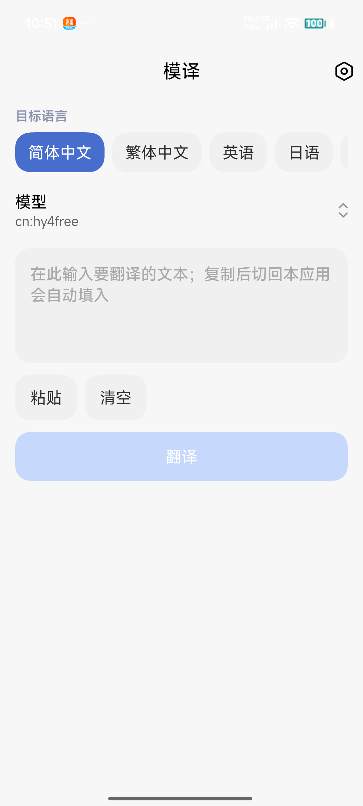
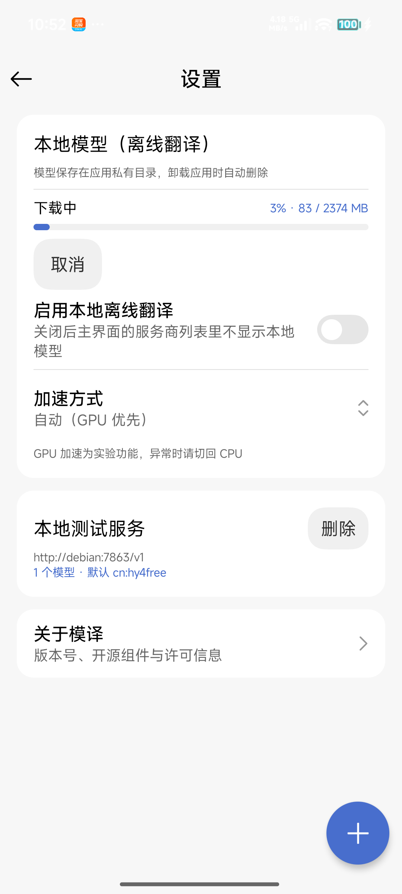
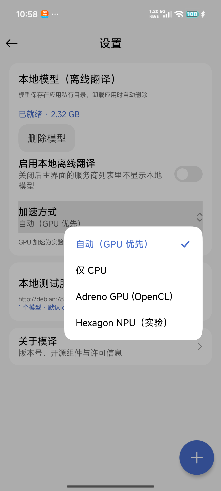
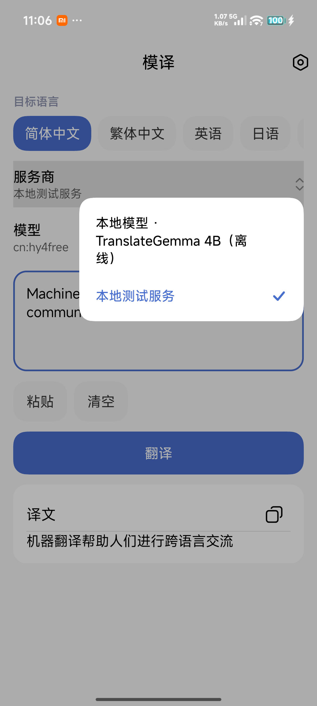
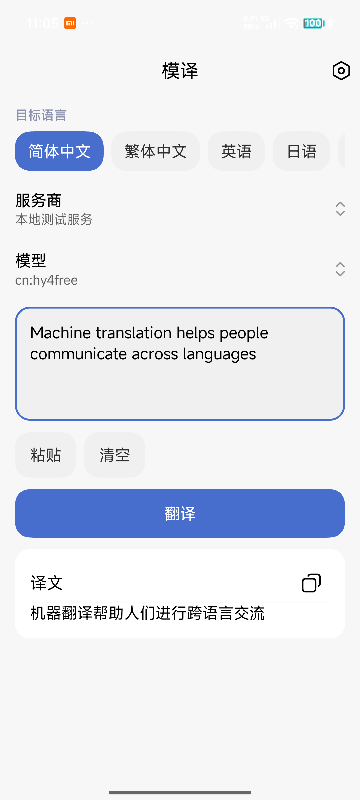
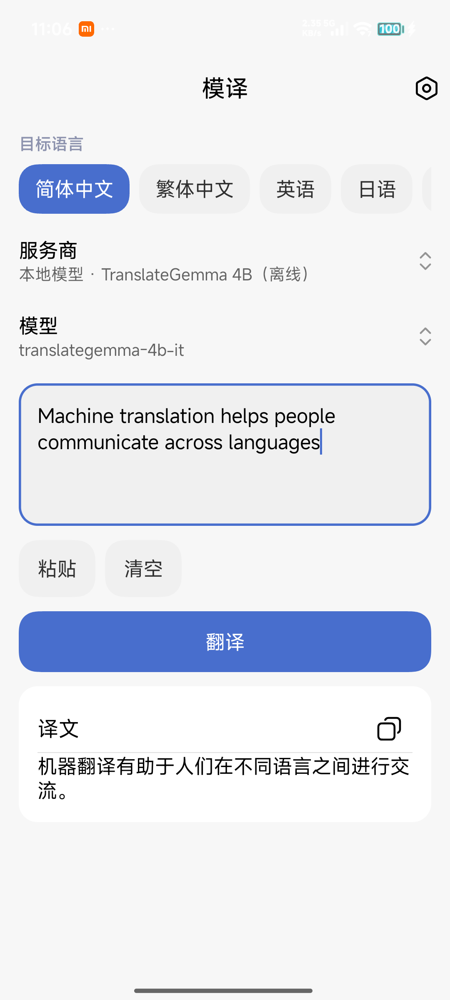
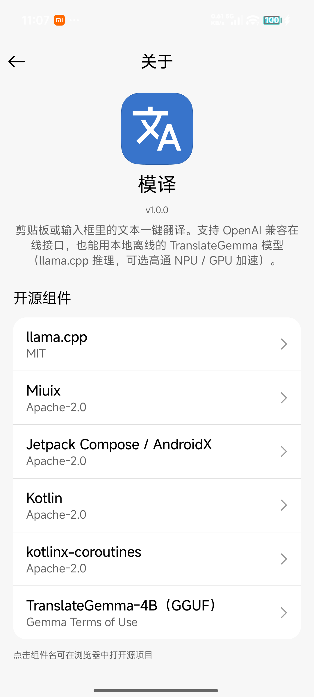
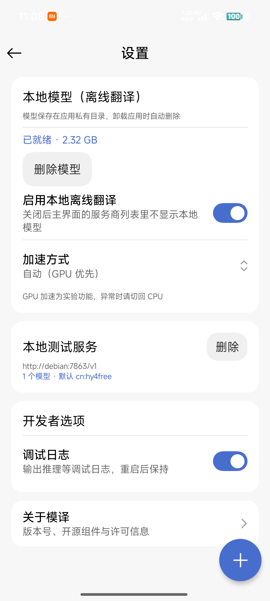

# 模译（ClipTranslate）

安卓剪贴板 / 输入翻译应用：复制或输入文本，一键翻译。支持 OpenAI 兼容的在线接口，也能用完全离线的本地模型。

## 功能

- **剪贴板自动填入**：复制文本后切回模译，内容自动带入输入框；也可以点「粘贴」手动再读一次，或直接输入。
- **目标语言选择**：简体中文、繁体中文、英语、日语等 20 种语言，默认简体中文。
- **在线翻译**：任意 OpenAI 兼容服务。可配置多个 Provider，填好 Base URL 和 API Key 后一键拉取模型列表，勾选即可添加。
- **离线本地翻译**：内置两个 GGUF（Q4_K_M）模型，可在设置里切换：TranslateGemma 4B（约 2.3 GB，需 8 GiB 以上机身内存）与 Index-Translate 2B（约 1.2 GB，4 GiB 机型也能用）。模型存放在应用私有目录、卸载应用时自动删除；推理由 llama.cpp 完成，可选「自动（GPU 优先）/ 仅 CPU / Adreno GPU (OpenCL) / Hexagon NPU（实验）」加速方式，切换时自动卸载并重新加载模型。
- **译文一键复制**：点译文卡片右上角的复制按钮即可把结果放进剪贴板。

## 使用方法

### 安装

- 从 [Releases](https://github.com/kisaragychihaya/ClipTranslate/releases) 下载 APK。
- 或到 [GitHub Actions](https://github.com/kisaragychihaya/ClipTranslate/actions) 下载 CI 构建的 APK 构件（push main 或手动触发，保留 7 天）。
- 系统要求 Android 8.0（API 26）及以上。

### 本地离线模型

设置 →「本地模型（离线翻译）」→ 在「模型」下拉里选择要用的模型，再点「下载」（TranslateGemma 4B 约 2.3 GB，Index-Translate 2B 约 1.2 GB；内存小的机型只列出跑得动的模型）。下载支持断点续传，完成后校验 SHA-256；两个模型可以各自下载，互不影响。翻译页的本地「模型」下拉只显示已下载完成的模型，两处选的是同一个模型（换一处另一处同步）。

下载完成后打开「启用本地离线翻译」，在「加速方式」里按需选择：

GPU 与 NPU 加速属实验功能，出现异常时切回「仅 CPU」；模型保存在应用私有目录，卸载应用即自动删除。

### 使用云端模型

点主界面右上角齿轮进入设置，点右下角「+」新建服务商，填名称、Base URL（如 `https://api.openai.com/v1`）和 API Key，点「拉取模型」勾选要用的模型后保存。回到主界面，在「服务商」「模型」下拉里选择即可——与本地模型并排，随时互切：

### 翻译

1. 复制任意文本，切回模译，内容会自动填入输入框（与当前输入或当前译文相同时不覆盖）。
2. 选好目标语言、服务商和模型。
3. 点「翻译」，译文出现在下方；点右上角复制按钮即可复制。

### 查看开源许可

设置最底部的「关于模译」进入关于页，可看到版本号与全部开源组件；点组件名会用浏览器打开对应源项目。

## 开发者

- **构建**：APK 由 GitHub Actions（`.github/workflows/build-apk.yml`）构建，push main、push `v*` tag 或手动触发，产物在 Actions 的 artifact 里。
- **本地环境**：不需要安装 Android SDK。装好 JDK 21 和 `kotlinc` 后运行 `bash tools/qc/syntax-check.sh`，做 Kotlin 语法检查。
- **开发者模式**：在关于页按住应用图标 3 秒开启，设置页会出现「开发者选项」，可开关调试日志、调整本地模型加载前的内存预检阈值（2.5~4.5 GB；未手动设置时按所选模型取默认值，4B 为 4 GB、2B 为 2 GB）；再长按一次即可关闭。

### 反馈问题（如何协助提交 bug）

1. 关于页长按图标 3 秒开启开发者模式，确认设置页「开发者选项」里的**调试日志**已打开（默认开）。
2. 复现一次问题。
3. 用电脑抓日志：`adb logcat -d -s CliptranslateJNI:* > log.txt`（本地推理的详细日志都在这个 tag 下）。
4. 提交 issue 时附上 `log.txt`、机型、系统版本和复现步骤。

## 开源许可

- [llama.cpp](https://github.com/ggml-org/llama.cpp) — MIT
- [Miuix](https://github.com/compose-miuix-ui/miuix) — Apache-2.0
- [Jetpack Compose / AndroidX](https://developer.android.com/jetpack) — Apache-2.0
- [Kotlin](https://kotlinlang.org) — Apache-2.0
- [kotlinx-coroutines](https://github.com/Kotlin/kotlinx.coroutines) — Apache-2.0
- [TranslateGemma-4B（GGUF）](https://www.modelscope.cn/models/42ailab/TranslateGemma-4B-GGUF) — Gemma Terms of Use
- [Index-Translate-2B（GGUF）](https://www.modelscope.cn/models/IndexTeam/Index-Translate-2B-GGUF) — Apache-2.0

以上组件的源项目链接同样可以在应用「关于」页点击打开。
